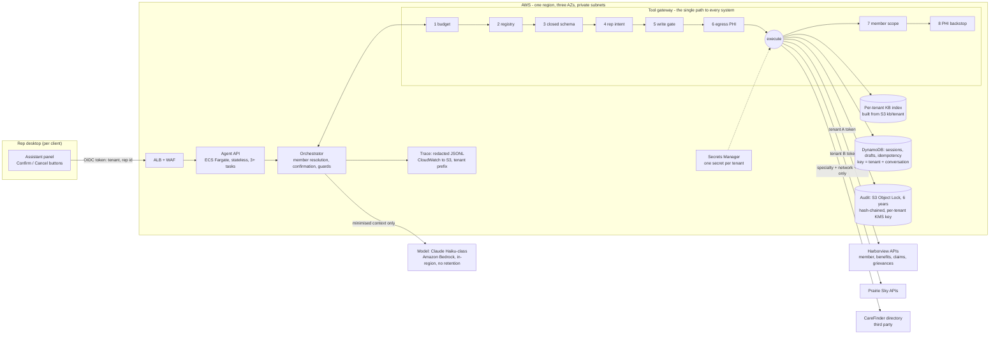

# Governed multi-tenant member-services agent — design

Scope: the target production deployment for the slice in this repository. Primary cloud **AWS**; mapping to
**Azure** in §4. NFR ids refer to the client statement of work.

## 1. Architecture

**Request flow.** The rep's token fixes the tenant; the conversation fixes the member. Before any model call
the orchestrator resolves the member *inside that tenant* (a miss ends the turn with a fixed reply and zero
tokens). It then retrieves plan passages scoped to tenant → product → plan year, and runs a short model/tool
loop. The model plans and words the answer; everything that must be right is deterministic: arithmetic and
date rules in tools, confirmation from the rep's own words or the Confirm button, writes by the gateway.

**Tenancy model: pooled compute, siloed data.** One stateless service serves both clients. Data is separated
structurally, not by a `WHERE tenant =` filter: per-tenant credential (looked up by the session's tenant only),
per-tenant KB index object, tenant-prefixed session keys, tenant-partitioned traces and audit, per-tenant KMS
keys. The same image can be deployed as a dedicated stack for one client (NFR-8) by configuration alone.

## 2. Responding to the NFRs — including where they conflict

| NFR | Design response | Status |
|---|---|---|
| 1 · 99.99% | Stateless tasks across 3 AZs, DynamoDB/S3 (multi-AZ by default), health-checked rolling deploys, circuit breakers per upstream. | **Conflict, see below** |
| 2 · single region, lowest cost | One region. No vector database or agent platform: the KB is ~14 small documents, indexed in-process from S3. Fargate + DynamoDB on-demand + S3. | Met |
| 3 · p95 < 3 s incl. claims | Claims are prefetched in the background when the call opens and cached for the conversation; claim-by-id is one call; answers stream. | **Conflict, see below** |
| 4 · isolation | §1 tenancy model; gateway steps 2, 3, 7; KB provenance check; tests assert no cross-tenant text in context, logs or answers. | Met; tested |
| 5 · PHI | Allow-list projections per tool; SSN never leaves the gateway (match/no-match only); redaction before any log sink; audit in WORM storage for 6 years. | Met; tested |
| 6 · confirmed, exactly once | Two-phase write (ADR-2), payload-derived idempotency key, retry only with the same key, reconciliation for unacknowledged writes. | Met; tested |
| 7 · ≤ $0.03 / conversation | ≈ 3 model calls, ≈ 9k input + 1k output tokens → **≈ $0.0015** at Haiku-class list price; infrastructure ≈ $1.5k/month ÷ 600k conversations ≈ **$0.0025**. Hard cap per conversation enforced by the gateway. | Met (≈ 7× headroom) |
| 8 · portability | Ports for model, session store, audit sink, secrets, retriever; containers + Terraform; no cloud-specific agent service (ADR-4). | Met by design |
| 9 · 250 concurrent reps | ≈ 4 turns/s at peak: 3 tasks suffice, autoscale to 12 on concurrency. The real limit is the client claims quota → per-tenant token bucket + prefetch. | Met |

**Three requirements cannot all hold as written; I would raise them before build, not after.**

- **NFR-1 vs NFR-2.** 99.99% is 4.3 minutes a month. A single region cannot promise that, and the assistant's
  availability is bounded by its dependencies (the client's own claims platform already returns 429/503; a
  model endpoint is typically 99.9%). Proposal: commit to **99.9% full function** and **99.99% "responds
  safely"** — the API always answers, degrading to an explicit *"claims system unavailable, benefits answers
  still work"* rather than failing. Reaching 99.99% full function needs a second region (and client approval
  to replicate PHI there); the stack is built to allow it, the year-1 budget does not.
- **NFR-3 vs the claims platform.** One claims call takes ~1.5 s; a member with 13 claims needs 3 sequential
  pages plus quota back-off — over 4.5 s before any model time. Prefetch-at-call-open moves that wait ahead of
  the first question (measured: see `reports/eval_report.md`), but a cold "count my denied claims" as the
  first utterance cannot meet 3 s. Ask the client for a larger page size / bulk endpoint, or a CDC feed into a
  tenant-scoped read store; until then the SLO should exclude cold multi-page claim listings.
- **NFR-7 vs model choice.** The budget is comfortable with a small model and is consumed ~20× faster by a
  frontier model. Because arithmetic, dates and writes are outside the model, a small model is sufficient;
  the eval gate is what tells us if a cheaper model stops being so.

## 3. Threat model

Trust boundaries: rep ↔ API; orchestrator ↔ model; gateway ↔ client APIs; gateway ↔ third party; service ↔ logs.
Assets: member PHI, tenant separation, integrity of the grievance record, the audit trail.

| # | Threat | Mitigation in this design | Residual |
|---|---|---|---|
| T1 | **Cross-tenant disclosure** via retrieval, cache, credentials, logs, or a member id that exists in both plans (one does). | Tenant from identity only; no tenant/member tool arguments; one KB index and one credential per tenant; session-scoped caches; documents whose folder and front-matter tenant disagree are quarantined (one supplied document is misfiled this way). | Misconfiguration of the tenant registry → config review + startup `doctor` check. |
| T2 | **Indirect prompt injection** in claim notes, KB prose and the vendor tool manifest (all three occur in the supplied pack). | Untrusted text is sanitised and labelled as data; vendor tool descriptions never reach the model; and — decisively — nothing injected text can ask for is reachable: no write without rep confirmation, no cross-member read, no identifiers in tool output. | Injection can still distort the *wording* of an answer; the rep sees source data in the desktop. |
| T3 | **PHI exfiltration** to the directory vendor, the model provider, or logs. | Egress guard on third-party arguments; only specialty, network id and 3-digit ZIP leave; minimum-necessary projections; model in-region under BAA with no retention; redaction before the sink, pseudonymised member ids. | Free-text typed by the rep reaches the model (full SSNs are masked first). |
| T4 | **Unauthorised or duplicate write** — model acts alone, confirmation is spoofed, retry creates a second grievance, double click. | Write tool is not model-callable; confirmation is derived from the rep's message or button, never from model/tool text; frozen payload; idempotency key = hash(tenant, member, conversation, payload); retry reuses key and bytes. | Two reps filing the same issue in separate conversations → duplicate check against open grievances (next step). |
| T5 | **Insider misuse** — browsing members, enumerating SSN digits. | Conversation bound to one member; SSN check returns match/no-match, three attempts per conversation; every access and write in the audit log with rep id. | Collusion; addressed by audit review, not prevention. |
| T6 | **Resource exhaustion / runaway agent.** | Per-conversation step, cost and latency budgets; per-tenant claims token bucket; WAF rate limits. | — |
| T7 | **Audit tampering / repudiation.** | Hash-chained records, S3 Object Lock (compliance mode), separate write-only role. | — |
| T8 | **Supply chain** — vendor changes its manifest; dependency compromise. | Manifest is pinned by hash and re-reviewed on change; our own tool contract is what the model sees; pinned, scanned dependencies. | — |

## 4. Mapping to a second cloud (Azure)

Chosen because NFR-8 names Prairie Sky's own tenancy on another provider from year 2. Nothing in the
application changes; adapters and infrastructure modules do.

| Concern | AWS (primary) | Azure (Prairie Sky tenancy) | Port in the code |
|---|---|---|---|
| Compute | ECS Fargate, 3 AZs | Azure Container Apps, zone-redundant | container image |
| Edge | ALB + WAF | Front Door / App Gateway + WAF | — |
| Identity | Cognito / client IdP via OIDC | Entra ID (OIDC) | `rep` dependency in `api.py` |
| Model | Claude on Amazon Bedrock | Claude on Microsoft Foundry, or Azure OpenAI | `ModelProvider` (Anthropic and OpenAI-compatible adapters exist) |
| Session, drafts, idempotency | DynamoDB (TTL, conditional writes) | Cosmos DB (TTL, ETag preconditions) | `Session` / `ActionStore` |
| KB documents | S3 `kb/<tenant>/` | Blob Storage container per tenant | `KnowledgeBase.load` |
| Audit (6 y, immutable) | S3 Object Lock, compliance mode | Blob immutable storage (WORM policy) | `AuditLog` |
| Traces / metrics | CloudWatch → S3, OpenTelemetry | Azure Monitor / Log Analytics, OpenTelemetry | `TraceSink` |
| Secrets, keys | Secrets Manager, KMS per tenant | Key Vault (secrets + keys) | `Settings.secret` |
| Network | VPC, PrivateLink to client APIs | VNet, Private Link | — |
| IaC | Terraform module `aws/` | Terraform module `azure/` | same variables |

Differences that matter: (1) model parity — the eval gate is run per cloud/model before cut-over, because the
same prompt on a different model is a different system; (2) DynamoDB conditional writes vs Cosmos ETags for
the idempotency record — same semantics, different failure codes; (3) a dedicated Prairie Sky stack removes
the pooled-compute risk for that client entirely and holds only one tenant's credential.

## 5. Architecture decision records

**ADR-1 — Tenant and member come from identity, never from the model.**
*Context:* isolation must hold even when the model is wrong or manipulated. *Decision:* a `TenantContext` is
bound at conversation start from the rep's credential; tools have closed schemas with no tenant or member
parameters; the gateway builds each client from the session tenant's credential. *Alternatives:* model
supplies ids and a filter checks them (one missed check is a breach); a deployment per tenant from day one
(strongest, but doubles run cost against NFR-2 — kept as the year-2 option). *Consequences:* a rep cannot
switch member mid-conversation (a new conversation is cheap); cross-member questions are refused by design.

**ADR-2 — Writes are two-phase and executed by the gateway, outside the model loop.**
*Context:* "only after explicit confirmation, exactly once", over a system of record that can commit and still
return 503. *Decision:* the model may only *draft*; the draft is frozen and read back; confirmation is taken
from the rep's own message (conservative classifier) or the Confirm endpoint; the gateway files the frozen
payload with a key derived from it and retries only with that key. *Alternatives:* a model-callable write tool
with a `confirmed` flag (the model decides when the rep agreed); an LLM judge for confirmation (injectable,
non-deterministic). *Consequences:* one extra turn per write; ambiguous replies are not confirmations, so an
occasional rep must say "confirm" again; unacknowledged writes surface as "unconfirmed", never as a silent
duplicate.

**ADR-3 — One retrieval index per tenant, lexical and row-level, with structured rule extraction.**
*Context:* benefit answers are table rows that differ by tenant, product and plan year; several eval
expectations are wrong precisely along those axes. *Decision:* ingest only documents whose folder and
front-matter agree; chunk tables by row with headers; BM25 scoped to product and plan year; parse deductible,
out-of-pocket, visit limits and timeframes into typed values used by tools. *Alternatives:* a shared vector
index with a metadata filter (isolation depends on every query carrying the filter; embeddings blur "$40" vs
"$70" rows); stuffing all documents into context (cost, and 2027 text next to 2026 questions). *Consequences:*
no embedding service to run or secure; lexical recall is adequate for ~200 rows and would be revisited
(hybrid search behind the same interface) for a large, prose-heavy corpus.

**ADR-4 — A thin, owned agent loop behind provider-neutral ports; no cloud agent service.**
*Context:* NFR-8 portability, evaluators running a different model, and the need to place a policy pipeline
in front of every tool call. *Decision:* ~150 lines of orchestration, a `ModelProvider` port with two
adapters, and the gateway as the only tool path. *Alternatives:* Bedrock Agents / Azure AI Agent Service
(faster start, but confirmation, isolation and tracing would be re-implemented per cloud); a general agent
framework (large surface for a loop this small). *Consequences:* we own retries, tracing and the loop — and
can test them deterministically with a scripted model.

**ADR-5 — Single region with an explicit degraded mode, rather than paying for multi-region in year 1.**
*Context:* NFR-1 and NFR-2 conflict (§2). *Decision:* multi-AZ, stateless, per-dependency circuit breakers;
every failure path returns a safe, explicit reply; availability is reported both as "responds safely" and
"full function". *Alternatives:* warm standby region (≈ +60% cost, PHI replication to approve); accept 99.9%
silently (hides the gap from the client). *Consequences:* a regional outage is an outage; the client signs
off on that trade knowingly, and the upgrade path is infrastructure-only.
